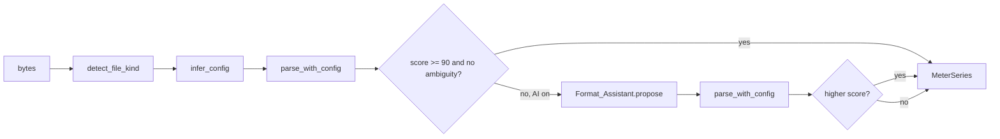

# Design Document: Meter Import

## Overview

The importer is a pipeline of deterministic stages. Heuristics and the AI reviewer both output a `ParseConfig`;
only `parse_with_config` turns bytes into numbers. That split is what lets an LLM help without being trusted.

## Components and Interfaces

| Module | Responsibility |
|---|---|
| `ingest/table.py` | magic-number detection, encoding, delimiter sniffing (decimal-comma aware), header row search |
| `ingest/infer.py` | column roles, layouts (long, wide, period index), units, cumulative detection, LCL preset |
| `ingest/numbers.py` | lenient number parsing, timestamp formats, DST-safe localisation |
| `ingest/greenbutton.py` | ESPI XML via defusedxml, ReadingType resolution, export and gas filtering |
| `ingest/parse.py` | the fixed seven-step normalisation (see module docstring) |
| `ingest/validate.py` | `ParseReport` and the 0–100 score |
| `ingest/pipeline.py` | orchestration and AI review |
| `llm/parse_assist.py` | runs the Kiro Crew `format-reviewer` agent; its JSON reply is validated against `ParseConfig` |

### Normalisation order

1. Row selection (fuel filter, meter selection)
2. Timestamps to UTC, values to floats
3. Native interval from the mode of timestamp gaps
4. Cumulative differencing, or end-mark shift
5. Unit conversion (power needs step 3)
6. Duplicate averaging, negative values to missing
7. Grid to the analysis interval (30 or 60 minutes)

### Why ties go to the assistant only after an ambiguity

The Quality_Score checks internal consistency: regular timestamps, coverage, a plausible median power. It cannot tell
W from Wh, or interval start from interval end, because both readings of the same file are equally consistent. In a
test file with columns `col_a, col_b, col_c` and a note "values are average watts ... stamped at the END", the
heuristic read Wh with start marks (score 100, total energy doubled) and the AI reviewer read W with end marks (score 100,
correct). Ties therefore go to the assistant when the heuristic itself reported an ambiguity, and to the heuristic
otherwise. The heuristic now also reads such preamble notes, so this case no longer depends on AI.

## Data Models

`ParseConfig` (pydantic, `extra="forbid"`) is the contract between heuristics, AI and parser. Every field is
documented for the model in the prompt of `crew-app/wattgeist-night-watch/agents/format-reviewer.json`, and the
JSON Schema is sent with every review request.

## Correctness Properties

*A property is a characteristic or behaviour that should hold across all valid executions of a system.*

### Property 1: Energy is conserved by parsing

*For any* regular series of interval readings in any supported time zone, unit (kWh, Wh or kW), timestamp marking
(start or end) and row order, parsing the CSV rendering SHALL produce a Canonical_Series whose sum equals the
series sum. kW is average power, so conservation only holds when the parser multiplies by the interval length,
which the property checks at 15, 30 and 60 minutes.

**Validates: Requirements 1.4, 2.1, 2.2**

### Property 2: The canonical grid is well formed

*For any* such series, the parsed index SHALL be UTC, unique, increasing, fixed-step, and start at the first true
interval start.

**Validates: Requirements 1.5, 2.2, 2.3**

### Property 3: Combining intervals never under-counts

*For any* 15-minute series with any set of missing readings, every non-missing 30-minute bucket SHALL equal the
full-data bucket, and every bucket containing a missing reading SHALL be missing.

**Validates: Requirements 1.6**

## Error Handling

| Situation | Result |
|---|---|
| Legacy `.xls` | message asking for `.xlsx` or `.csv` |
| No timestamp or value column | ambiguity, AI review if available, then a user-facing error |
| XML with DTD or entities | parse error from defusedxml, no file access |
| AI timeout or refusal | heuristic result kept, warning logged |

## Testing Strategy

- `tests/unit/test_ingest_formats.py`: one end-to-end test per real-world format, generated from the same truth series.
- `tests/property/test_properties.py`: Properties 1–3 with Hypothesis (60 examples each in CI).
