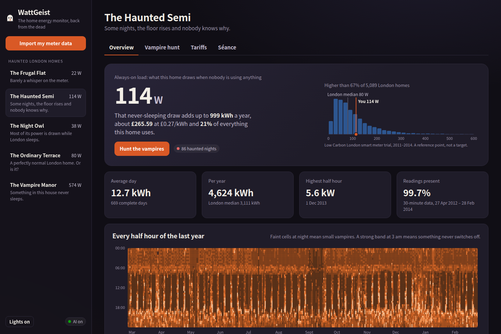
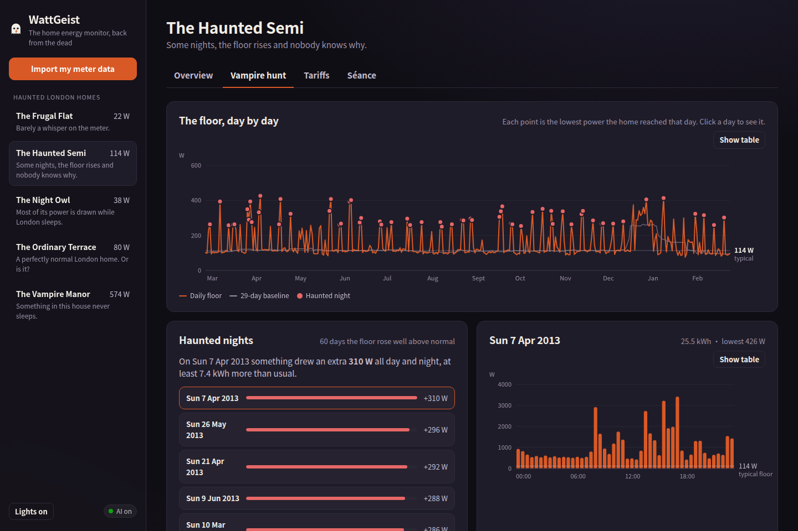
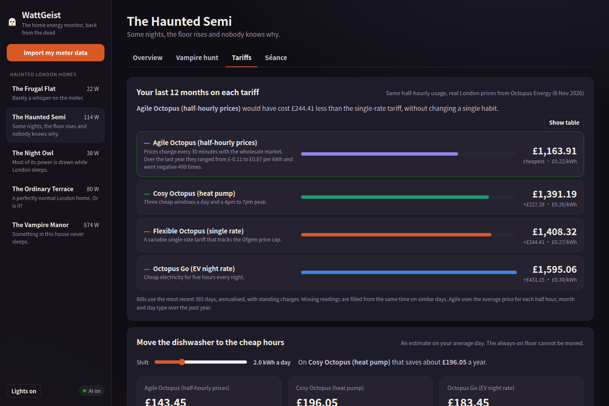
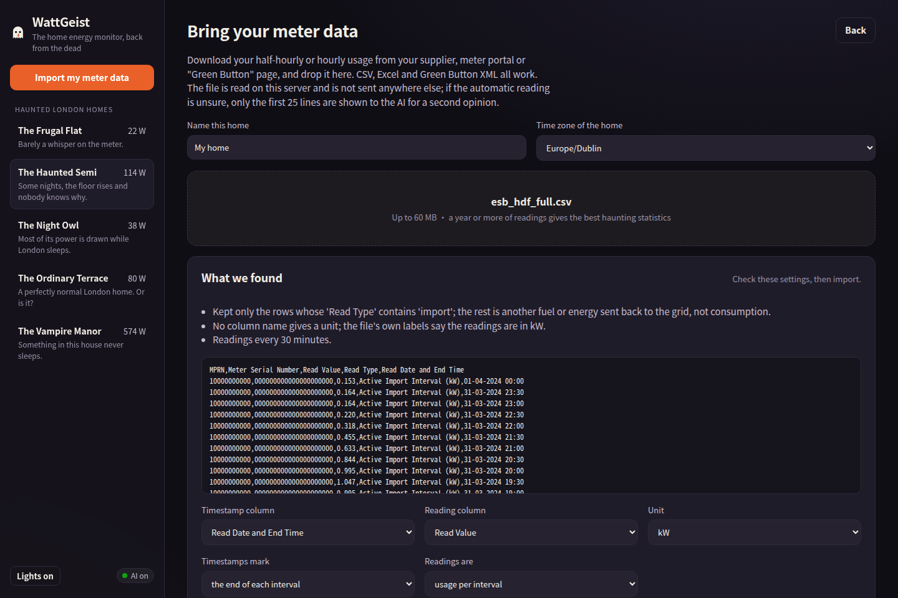

# 👻 WattGeist

**The home energy monitor, back from the dead.** Drop in the smart meter export your supplier already gives you, and
WattGeist finds the *vampire load*: what your home burns when nobody is using anything, what it costs, the nights
something was left on, and which tariff would have been cheapest.

> Kiroween 2026 · Category: **Resurrection**



## What came back from the dead

Google PowerMeter (2009–2011) and Microsoft Hohm (2009–2012) promised to show households where their electricity
went. Both were switched off because they depended on utility partnerships to get the data. Fifteen years later most
households can download their own half-hourly readings, but every supplier exports a different file.
WattGeist reads those files, with no utility partner and no column mapping.

## Features

| Feature | What it does |
|---|---|
| **Meter import** | CSV, Excel or Green Button XML. Detects preambles, day/month order, decimal commas, wide one-row-per-day layouts, period numbers (Spain's `Hora` 1–25), register totals, W/kW/Wh/kWh, interval-end stamps, DST, mixed gas/electric files, import/export channels (Ireland's ESB HDF) and exported solar. A Kiro Crew agent reviews only when the automatic reading is unsure, from a 25-line preview. |
| **Vampire hunt** | The always-on floor in W, its yearly kWh and cost, a percentile against 5,089 London homes, the floor day by day, **haunted nights** (days the floor rose well above its local baseline) and a suspect-device checklist with NRDC-measured standby watts. |
| **Tariff simulator** | Your last 12 months re-billed on real Octopus Energy tariffs (single rate, Go, Cosy, half-hourly Agile), plus what moving flexible load to the cheap hours would save. |
| **Séance** | Ask questions in plain English. A Kiro Crew agent answers only from the WattGeist MCP tools. |
| **Night Watch** (Kiro Crew app) | Every morning, pulls your Octopus readings and tells you on your phone if last night was haunted. |
| **MCP server** | The same analysis as tools for Kiro or any MCP client. |

| Vampire hunt | Tariffs | Import |
|---|---|---|
|  |  |  |

### What the demo homes show

Five real London households from the Low Carbon London smart meter trial ship with the app.

| Home | Always-on | Per year | Share of use | London percentile | Haunted nights |
|---|---|---|---|---|---|
| The Frugal Flat | 22 W | £51.25 | 17% | 8th | 0 |
| The Night Owl | 38 W | £88.54 | 2% | 20th | 21 |
| The Ordinary Terrace | 80 W | £186.38 | 22% | 50th | 1 |
| The Haunted Semi | 114 W | £265.59 | 21% | 67th | 86 |
| The Vampire Manor | 574 W | £1,337.30 | 44% | 99th | 9 |

The Haunted Semi's 86 haunted nights cluster on Saturdays and Sundays (68 of 86). Its median weekend floor is 262 W
against 110 W on weekdays: something is switched on every weekend and left running day and night.

Costs use the Octopus single-rate price in the bundled snapshot (£0.26596/kWh, London, November 2026).

### Formats tested

Every format below is generated from one known year of half-hourly readings and imported with no AI. Each one
reproduces the total energy within 0.2% and scores 100.

| Country | Export |
|---|---|
| UK | Octopus Energy consumption CSV, Low Carbon London, wide one-row-per-day |
| US | PG&E Green Button CSV (preamble, gas rows, hourly), Green Button ESPI XML with a solar export block |
| Ireland | ESB Networks HDF (kW, import and export channels) |
| Germany | Register totals, semicolons, decimal commas, 15-minute |
| Spain | i-DE hourly with `Hora` period numbers across DST |
| Any | Excel with notes above the header, readings in Wh |

## Run it

Requirements: Python 3.12 with [uv](https://docs.astral.sh/uv/), Node.js 22.

```bash
# backend
cd backend
uv sync
uv run wattgeist-api            # http://127.0.0.1:8000

# frontend (another terminal)
cd frontend
npm ci
npm run dev                     # http://127.0.0.1:5173, proxies /api to :8000
```

Or build once and serve everything from the API:

```bash
cd frontend && npm ci && npm run build && cd ../backend && uv run wattgeist-api
```

Or with Docker:

```bash
docker build -t wattgeist .
docker run -p 8000:8000 wattgeist   # AI features off: the image has no Kiro Crew
```

### AI features

The import review and the Séance are Kiro Crew agents from the Night Watch app (`format-reviewer` and `seance` in
`crew-app/wattgeist-night-watch/agents/`). The API runs them with `kirocrew chat --agent ... -m ...`; Kiro Crew
owns the model, the sign-in and the tool loop, and WattGeist calls no model API itself. To switch them on, install
Kiro Crew, sign in to Kiro and install the app (see `crew-app/wattgeist-night-watch/README.md`), then start the API
on the same machine. `WATTGEIST_KIROCREW` points at a non-standard `kirocrew` binary.
Without Kiro Crew the rest of the app works: automatic import, vampire hunt, tariffs and Night Watch need no AI.

### Try your own data

- **UK, Octopus Energy**: download "consumption" from your account, or let Night Watch pull it with your API key.
- **US**: most utilities offer "Green Button: Download my data" (CSV or XML).
- **Anywhere else**: any CSV or Excel with timestamps and readings. Test files for eight formats are generated in
  `backend/tests/fixtures.py`.

## How it was built with Kiro

The full write-up is in [`docs/kiro-usage.md`](docs/kiro-usage.md). In short:

| Kiro feature | Where |
|---|---|
| Specs (requirements in EARS, design with correctness properties, tasks) | `.kiro/specs/` |
| Steering (product, tech, energy-domain rules, frontend design) | `.kiro/steering/` |
| Hooks (tests and lint on save, generated-data guard, spec sync on stop, fixture review) | `.kiro/hooks/` |
| Custom agents (`meter-format-detective`, `vampire-analyst`) | `.kiro/agents/` |
| MCP (WattGeist analysis tools) | `.kiro/settings/mcp.json`, `backend/src/wattgeist/mcp_server.py` |
| Property-based testing (Hypothesis, fast-check) | `backend/tests/property/`, `frontend/src/lib/format.test.ts` |
| Kiro Crew app (installed and run in a Crew 0.12 gateway) | `crew-app/wattgeist-night-watch/` |

## Tests

```bash
cd backend && uv run pytest -q && uv run ruff check src tests
cd frontend && npx vitest run && npx tsc -b
```

## Data and credits

- Demo homes and London benchmark: [SmartMeter Energy Consumption Data in London Households](https://data.london.gov.uk/dataset/smartmeter-energy-consumption-data-in-london-households-vqm0d),
  UK Power Networks, London Datastore, [CC BY 4.0](https://creativecommons.org/licenses/by/4.0/).
- Standby watts: NRDC, [Home Idle Load (2015)](https://www.nrdc.org/sites/default/files/home-idle-load-IP.pdf), Table 3.
- Tariffs: Octopus Energy public API, London region, fetched 6 November 2026.
- Methodology: [`docs/methodology.md`](docs/methodology.md).

WattGeist is not affiliated with Google, Microsoft, Octopus Energy or UK Power Networks.

## License

[MIT](LICENSE)
